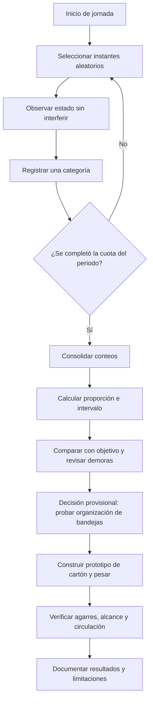

# Diagrama del proceso y decisión provisional

## Plan de muestreo
Para n=323: inicio 108, mitad 107 y final 108 observaciones. Dentro de cada bloque, elegir horarios aleatorios. Registrar fecha, bloque horario, estado observado y observador; evitar identificar personas. Distribuir en más de un día si la jornada o variabilidad lo requieren.

## Decisión provisional
La espera automática representa 30 % y la búsqueda de bandejas 10 %. Como hipótesis, probar una ubicación estandarizada de bandejas y materiales frecuentes dentro del alcance cómodo P5 de 320 mm. Medir antes y después con el mismo método. No afirmar causalidad ni ahorro real sin evaluación comparativa.
